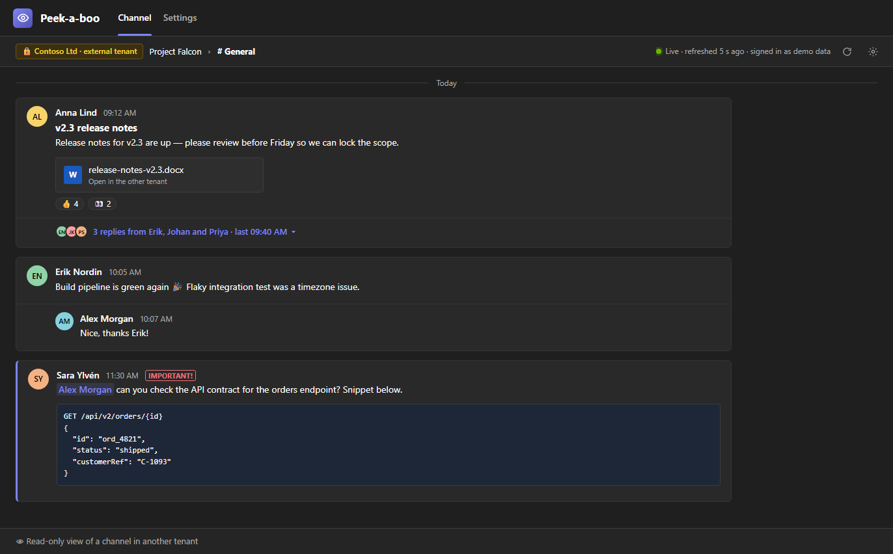

# Peek-a-boo

A Teams app that shows a **read-only, auto-refreshing view of a channel in another Microsoft 365 tenant**, without switching tenants in Teams. You sign in with your guest account in the other tenant, and the app reads the channel through Microsoft Graph.



- Personal app (left rail) with **Channel** and **Settings** tabs, and a tab you can pin in a channel, group chat or meeting chat in your own tenant.
- Shows posts, replies (collapsible), @mentions, files, inline images, reactions and importance, and refreshes every 30 seconds.
- Follows the Teams light, dark and high-contrast themes.
- Static single-page app with no backend. Tokens stay in the browser.

## How it works

```
Teams (tenant A) ──iframe──▶ index.html ──Graph (token for tenant B)──▶ /teams/{id}/channels/{id}/messages
                                 │
                                 └─ sign-in: Teams auth window → auth-start.html → login.microsoftonline.com/{tenant B} → auth-end.html
```

Teams single sign-on only issues tokens for your home tenant. The app therefore runs its own MSAL sign-in with the authority pinned to the **other** tenant, inside the Teams-managed auth window.

## Prerequisites

1. **A guest account in the other tenant** (tenant B) that is a member of the team.
2. **Admin consent in tenant B.** `ChannelMessage.Read.All` (delegated) always needs an admin. A tenant B admin opens the consent link once. The app shows it under Settings → *Copy admin consent link*:
   `https://login.microsoftonline.com/{tenantB}/v2.0/adminconsent?client_id={clientId}&scope=https://graph.microsoft.com/.default&redirect_uri=https://{host}/auth-end.html`
3. **Custom app upload allowed** in your own tenant (tenant A), or an admin who uploads the package for you.
4. Tenant B's cross-tenant access and Conditional Access settings must allow your guest account to sign in to third-party apps.

## Setup

### 1. Register the app (Entra ID, in your own tenant)

1. Go to Entra admin center → App registrations → **New registration**.
   - Supported account types: **Accounts in any organizational directory (multitenant)**
   - Redirect URI: platform **Single-page application (SPA)**, `https://<host>/auth-end.html`
     (also add `https://localhost:5173/auth-end.html` for local development)
2. API permissions → Microsoft Graph → **Delegated**: `User.Read`, `Team.ReadBasic.All`, `Channel.ReadBasic.All`, `ChannelMessage.Read.All`.
3. Copy the **Application (client) ID**.

### 2. Configure

```powershell
Copy-Item .env.example .env
# Set VITE_CLIENT_ID, APP_HOST and TEAMS_APP_ID (generate with [guid]::NewGuid())
npm install
```

### 3. Host the site (HTTPS required)

- **GitHub Pages:** push to `main`, set repository variables `VITE_CLIENT_ID` (and optionally `VITE_DEFAULT_TENANT`), and enable Pages with source *GitHub Actions*. The workflow is [.github/workflows/deploy.yml](.github/workflows/deploy.yml). Pages on a private repository needs a paid GitHub plan.
- **Anywhere else:** `npm run build`, then serve `dist/` as static files (Azure Static Web Apps, Storage static website, and so on).

`APP_HOST` is the host plus any path, without `https://`. Examples: `contoso.github.io/machack-teams-peek-a-boo`, or `localhost:5173` for local development.

### 4. Build and install the Teams package

Download `peek-a-boo-<version>.zip` from the [Releases](../../releases) page. Pushing a `v*` tag builds it with [.github/workflows/release.yml](.github/workflows/release.yml), which needs the repository variable `TEAMS_APP_ID`. Or build it locally:

```powershell
npm run package        # → appPackage/build/peek-a-boo.zip
```

In Teams desktop, go to **Apps → Manage your apps → Upload an app → Upload a custom app**, then pick the zip.

## Using it

1. Open **Peek-a-boo** from the left rail and go to **Settings**.
2. Paste a channel link (in Teams: **…** next to the channel → **Get link to channel**), or type the other tenant (`contoso.com` or its tenant ID). Then select **Sign in** and use your guest account.
3. Pick the team and channel, then select **Save**. The **Channel** tab now shows the conversation.

To pin it next to a chat or channel in your own tenant, use **+ (Add a tab) → Peek-a-boo** and pick the channel in the setup dialog.

## Local development

```powershell
npm run dev                        # https://localhost:5173 (self-signed cert)
# https://localhost:5173/index.html?demo   → sample data, no sign-in needed
```

Outside Teams the pages work in a normal browser, and sign-in uses a popup. To try it inside Teams locally, expose the dev server over trusted HTTPS (for example `devtunnel host -p 5173 --allow-anonymous`). Then set `APP_HOST` to the tunnel host, add its `/auth-end.html` as a SPA redirect URI, and run `npm run package`.

## Project layout

| Path | Purpose |
| --- | --- |
| [src/main.ts](src/main.ts) | Channel viewer: load, poll, render, error/consent states |
| [src/config.ts](src/config.ts) | Settings page and configurable-tab setup (`pages.config`) |
| [src/auth.ts](src/auth.ts) | MSAL per external tenant, Teams/browser sign-in, token hand-off |
| [src/auth-start.ts](src/auth-start.ts), [src/auth-end.ts](src/auth-end.ts) | Pages running inside the sign-in window |
| [src/graph.ts](src/graph.ts) | Microsoft Graph calls (teams, channels, messages, hosted content) |
| [src/render.ts](src/render.ts) | Message rendering, sanitized with DOMPurify |
| [src/demo.ts](src/demo.ts) | Sample data for `?demo` |
| [appPackage/](appPackage/) | Teams manifest template and icons |
| [design/](design/) | Approved mock and screenshots |

## Limitations

- Read-only by design, so you can't post or react from the app.
- Polls every 30 seconds while visible. Graph change notifications would need a backend.
- Shows the latest 30 root posts first. Use **Load older messages** for more.
- If MSAL's cache isn't shared between the Teams auth window and the tab, you may need to sign in again after restarting Teams.
